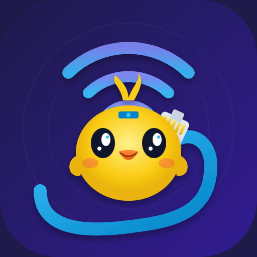

<p align="center">
  
</p>

<h1 align="center">Intercom LAN</h1>

<p align="center">
  Pasarse mensajes y archivos entre las máquinas de la red local — sin nube, sin cuentas, sin límites raros.
</p>

---

## 🎯 Qué quiero hacer

La idea es simple: en la oficina (o en casa) todos estamos en el **mismo WiFi**, pero
para pasarnos un archivo terminamos usando WhatsApp Web, mail, un pendrive o subiéndolo
a algún lado. **Eso es absurdo si las máquinas están a 2 metros.**

**Intercom LAN** es un intercomunicador de red local: abrís la app (o la web), las demás
máquinas aparecen solas, y les mandás **texto o archivos al instante**. Todo viaja
**directo de una máquina a otra por la red** — nada sale a internet.

Pensado como un **hobby para compartir con los compañeros**: cada uno lo instala, se
unen a un **grupo**, y listo.

### Principios

- **Cero dependencias de internet.** Descubrimiento por broadcast UDP; transferencia HTTP directa.
- **Que "funcione y ya".** Lo abrís y las PCs/celulares aparecen solos.
- **Multiplataforma.** Windows, Linux/macOS y Android, hablando el mismo protocolo.
- **Simple de compartir.** Un QR para vincular el celular; grupos para separar equipos.
- **Privado por diseño.** Es una red local de confianza; nada se publica afuera.

---

## 🧩 Cómo funciona

- Cada máquina corre un pequeño demonio (Node en PC/Linux, servicio nativo en Android).
- Se **anuncia por UDP** (puerto 7778) y escucha a las demás → la lista de equipos se arma sola.
- Para mandar algo, hace un **POST HTTP** directo al equipo destino (puerto 7777).
- Un **grupo** = una clave compartida: solo las máquinas con la misma clave se ven entre sí.
  El **pool de grupos** muestra qué grupos están activos en la red.

---

## 📦 Qué hay en el repo

| Carpeta | Qué es |
|---|---|
| raíz (`server.js`, `mcp.js`, `public/`) | Versión **Windows** (Node.js). `iniciar.bat` para arrancar. |
| `linux/` | **Fork Linux/macOS**: mismo código + `iniciar.sh` y servicio `systemd`. |
| `android/` | **App Android (Kotlin)**: chat, recibir/enviar archivos y APKs a la carpeta que elijas. |

---

## ✅ Lo que ya anda

- Mensajes y archivos en vivo entre PCs y celular.
- Descubrimiento automático + alta manual por IP.
- **Interfaz web** (PC) estilo chat, con modo claro/oscuro del sistema.
- **App Android** estilo chat, **modo oscuro por defecto** (+ opción claro).
- **Grupos**: crear/entrar, con **pool visible** de grupos activos.
- **Vincular el celular por QR** (3 escáneres a elegir: ZXing vertical/horizontal y Google ML Kit).
- **Recepción con confirmación** y **rate limit** (10 archivos / 10 min) en la web.
- **Ejecución remota opcional** y con consentimiento (apagada por defecto, exige clave, queda logueada).
- **Servidor MCP** para manejarlo desde un agente.

## 🛣️ Lo que quiero sumar

- [ ] Publicar el **APK como release** del repo para instalar fácil.
- [ ] **Historial persistente** y búsqueda de mensajes/archivos.
- [ ] Pool de grupos y envío de archivos **también desde la app**.
- [ ] **Arrastrar y soltar** carpetas enteras (zip al vuelo).
- [ ] Reanudar transferencias interrumpidas (archivos grandes).
- [ ] Ícono/estado por tipo de equipo (PC, celu, server).
- [ ] Empaquetar la versión PC como ejecutable (sin instalar Node).

---

## 🚀 Arranque rápido

**Windows**
```bat
node server.js --abrir
```
Abre <http://localhost:7777>. Las demás máquinas con el Intercom abierto aparecen solas.

**Linux / macOS** — ver [`linux/README.md`](linux/README.md).

**Android** — abrir `android/` en Android Studio y Run, o instalar el APK de
`android/app/build/outputs/apk/debug/`. Detalle en [`android/README.md`](android/README.md).

---

## 🔐 Grupos y clave

Definí una clave (la misma en todas las máquinas) para separar tu equipo del resto.
Vacía = grupo **general**. Desde la web, botón **👥 Grupo**; en el celu, **Ajustes → Grupo**
o escaneando el **QR** de una PC.

> Nota: solo se ven y se hablan las máquinas del **mismo grupo**. Si un mensaje "no llega",
> casi siempre es que los equipos están en grupos distintos.

---

## 🤝 Colaborar

Es un proyecto de equipo/hobby. Si tenés acceso al repo:

1. Cloná y creá una rama (`feat/...`, `fix/...`).
2. Commits con [Conventional Commits](https://www.conventionalcommits.org/) (`feat:`, `fix:`, `docs:`…).
3. Abrí un PR a `main`.

Stack: Node.js (sin dependencias), Kotlin + AndroidX/Material para la app.

---

<p align="center"><sub>Hecho para dejar de mandarnos archivos por WhatsApp estando en la misma red. 🐤</sub></p>
